# Database Architecture & Prisma Schema Documentation

This document describes the PostgreSQL 18 database architecture, Prisma 7 ORM configuration, schema design, referential integrity rules, indexing strategies, and seed workflows for `express-server`.

---

## 1. Overview & Technology Stack

- **RDBMS**: PostgreSQL 18
- **ORM**: Prisma ORM 7.x
- **Driver**: `@prisma/adapter-pg` + `pg` (PostgreSQL client pool)
- **Primary Keys**: Universally Unique Identifiers (UUIDv4)
- **Code Generation**: Output directed to `../src/generated/prisma` for ESM compatibility

---

## 2. Entity-Relationship Model

```mermaid
erDiagram
    ApplicationUser ||--o{ UserRole : "assigned"
    Role ||--o{ UserRole : "has"
    Role ||--o{ RolePermission : "contains"
    Permission ||--o{ RolePermission : "granted"
    ApplicationUser ||--o{ AuditLog : "acts"

    ApplicationUser {
        uuid id PK
        string auth0_user_id UK
        string email UK
        boolean email_verified
        string first_name
        string last_name
        string display_name
        string profile_picture
        boolean is_active
        boolean is_blocked
        timestamp last_login_at
        timestamp created_at
        timestamp updated_at
    }

    Role {
        uuid id PK
        string name UK
        string description
        boolean is_system
        boolean is_active
        timestamp created_at
        timestamp updated_at
    }

    Permission {
        uuid id PK
        string name UK
        string description
        timestamp created_at
        timestamp updated_at
    }

    UserRole {
        uuid id PK
        uuid user_id FK
        uuid role_id FK
        timestamp assigned_at
    }

    RolePermission {
        uuid id PK
        uuid role_id FK
        uuid permission_id FK
        timestamp assigned_at
    }

    AuditLog {
        uuid id PK
        uuid actor_user_id FK
        varchar action
        varchar resource
        varchar resource_id
        varchar status
        varchar ip_address
        text user_agent
        varchar correlation_id
        jsonb metadata
        timestamp created_at
    }
```



---

## 3. Schema Models and Constraints

### 3.1. `ApplicationUser` (`application_users`)
Stores synchronized user identity metadata associated with Auth0 subjects.
- `id`: UUID primary key.
- `auth0UserId`: Unique identifier corresponding to Auth0's `sub` claim (`auth0|...`, `google-oauth2|...`).
- `email`: Normalized lowercase user email address.
- `is_active` / `is_blocked`: Account state flags. Inactive or blocked accounts are denied access by authentication middleware.
- **Indexes**:
  - Unique index on `auth0_user_id`
  - Unique index on `email`
  - Compound index on `(is_active, is_blocked)`

### 3.2. `Role` (`roles`)
Stores system and custom application roles.
- `name`: Unique role identifier (`SUPER_ADMIN`, `ADMIN`, `MANAGER`, `USER`, `VIEWER`, or custom strings).
- `is_system`: When `true`, prevents deletion and renaming.
- `is_active`: Controls whether the role can be assigned.
- **Indexes**: Unique index on `name`.

### 3.3. `Permission` (`permissions`)
Stores atomic resource-action capabilities (`<resource>:<action>`).
- `name`: Unique permission token (`users:read`, `users:update`, `roles:assign`, etc.).
- **Indexes**: Unique index on `name`.

### 3.4. `UserRole` (`user_roles`)
Junction table managing many-to-many relationships between users and roles.
- Foreign Key `user_id` -> `application_users.id` (`onDelete: Cascade`)
- Foreign Key `role_id` -> `roles.id` (`onDelete: Restrict`)
- Unique compound constraint on `(user_id, role_id)` prevents duplicate assignments.

### 3.5. `RolePermission` (`role_permissions`)
Junction table managing many-to-many relationships between roles and permissions.
- Foreign Key `role_id` -> `roles.id` (`onDelete: Cascade`)
- Foreign Key `permission_id` -> `permissions.id` (`onDelete: Restrict`)
- Unique compound constraint on `(role_id, permission_id)`.

### 3.6. `AuditLog` (`audit_logs`)
Append-only tamper-resistant audit trail recording administrative actions, role modifications, and critical system events.
- Foreign Key `actor_user_id` -> `application_users.id` (`onDelete: SetNull` preserves audit trail if a user record is removed).
- `metadata`: JSONB column for arbitrary contextual parameters.
- **Indexes**:
  - `actor_user_id`, `action`, `resource`, `resource_id`, `status`, `correlation_id`, `created_at`

---

## 4. Database Seed Workflow

The seed script (`prisma/seed.ts`) is idempotent and initializes all required system roles, permissions, and default role-permission mappings.

### System Roles Seeded:
1. `SUPER_ADMIN`: Root administrator with wildcard permission (`*`).
2. `ADMIN`: Full resource management capabilities.
3. `MANAGER`: Operational privileges across users and dashboard.
4. `USER`: Standard end-user with self-profile and read dashboard access.
5. `VIEWER`: Read-only observer role.

### Permissions Seeded:
- `users:read`, `users:create`, `users:update`, `users:delete`
- `roles:read`, `roles:create`, `roles:update`, `roles:delete`, `roles:assign`
- `permissions:read`, `permissions:manage`
- `dashboard:read`
- `audit-logs:read`

### Executing Seed:
```bash
# Run migrations to ensure schema is up-to-date
npx prisma migrate dev

# Run the idempotent seed script
npm run prisma:seed
```

