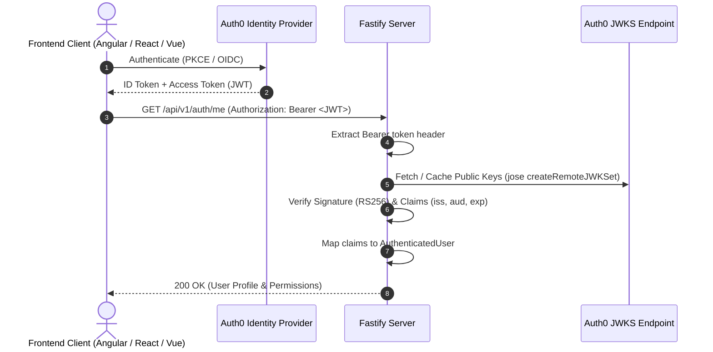

# Auth0 Integration Guide — Fastify Server

This document details the Auth0 integration architecture, token verification mechanics, preHandler hooks, and frontend integration contracts for `fastify-server`.

---

## 1. Architectural Philosophy

**Auth0 manages authentication and identity. Fastify verifies tokens and authorizes resources.**

The Fastify application does NOT:
- Issue access tokens or refresh tokens.
- Handle password hashing or credential storage.
- Implement login or registration forms.

The Fastify application:
- Verifies Auth0-issued asymmetric JSON Web Tokens (JWT) using Auth0's JSON Web Key Set (JWKS).
- Validates token claims: signature, expiration (`exp`), not-before (`nbf`), issuer (`iss`), and audience (`aud`).
- Extracts user identity, OAuth scopes, permissions, and namespaced roles.
- Protects routes with idiomatic Fastify `preHandler` hooks (`authenticate` and `optionalAuthenticate`).

---

## 2. Token Verification Architecture



---

## 3. Cryptographic Verification Details

- **Library**: `jose` (v6.x)
- **Algorithm**: `RS256` (Asymmetric RSA Signature with SHA-256)
- **Public Key Resolution**: `createRemoteJWKSet` against `https://${AUTH0_DOMAIN}/.well-known/jwks.json`
- **JWKS Cache Strategy**:
  - `cacheMaxAge`: 10 minutes (`600,000ms`)
  - `cooldownDuration`: 30 seconds (`30,000ms`)
  - `timeoutDuration`: 5 seconds (`5,000ms`)
- **Key Rotation**: Automatic. If a token arrives with an unknown `kid` (Key ID), `jose` refetches the JWKS adhering to cooldown limits.

---

## 4. Environment Configuration

```bash
# Auth0 Identity Provider Configuration
AUTH0_DOMAIN=your-tenant.auth0.com
AUTH0_AUDIENCE=https://api.auth0-system.com
AUTH0_ISSUER_BASE_URL=https://your-tenant.auth0.com/
AUTH0_JWKS_URI=https://your-tenant.auth0.com/.well-known/jwks.json
AUTH0_ALGORITHMS=RS256
AUTH0_CLOCK_TOLERANCE=5
AUTH0_ROLES_CLAIM_NAMESPACE=https://api.auth0-system.com/roles
```

---

## 5. Fastify Authentication PreHandler Hooks

### Usage in Routes

```typescript
import { authenticate, optionalAuthenticate } from '../../plugins/auth.plugin.js';

// 1. Mandatory Authentication (Route protected)
fastify.get('/me', { preHandler: [authenticate] }, async (request, reply) => {
  const user = request.auth!; // AuthenticatedUser is guaranteed
  return { sub: user.sub, scopes: user.scopes };
});

// 2. Optional Authentication
fastify.get('/public-or-personal', { preHandler: [optionalAuthenticate] }, async (request, reply) => {
  if (request.auth) {
    // Authenticated user experience
  } else {
    // Anonymous user experience
  }
});
```

---

## 6. Endpoints Reference

### `GET /api/v1/auth/status` (Public)
Returns integration status without disclosing secrets or JWKS internals.

**Response (200 OK):**
```json
{
  "success": true,
  "message": "Auth0 integration status",
  "data": {
    "provider": "Auth0",
    "configured": true,
    "domain": "your-tenant.auth0.com",
    "audience": "https://api.auth0-system.com",
    "issuer": "https://your-tenant.auth0.com/"
  },
  "timestamp": "2026-11-15T20:00:00.000Z"
}
```

### `GET /api/v1/auth/me` (Authenticated)
Returns verified identity and claim metadata. Requires `Authorization: Bearer <token>`.

**Response (200 OK):**
```json
{
  "success": true,
  "message": "Authenticated user retrieved successfully",
  "data": {
    "sub": "auth0|64f1a2b3c4d5e6f7",
    "issuer": "https://your-tenant.auth0.com/",
    "scopes": ["openid", "profile", "email"],
    "permissions": ["users:read", "dashboard:read"],
    "roles": ["USER"],
    "claims": {
      "email": "user@example.com",
      "email_verified": true,
      "nickname": "jdoe"
    }
  },
  "timestamp": "2026-11-15T20:00:00.000Z"
}
```

---

## 7. Error Codes Reference

| Error Code | HTTP Status | Trigger Condition |
|---|---|---|
| `AUTHENTICATION_REQUIRED` | 401 | Missing `Authorization` header |
| `INVALID_TOKEN_FORMAT` | 401 | Header not prefixed with `Bearer ` or token is empty |
| `TOKEN_EXPIRED` | 401 | Token `exp` timestamp is in the past |
| `INVALID_TOKEN_SIGNATURE` | 401 | Signature verification failed against JWKS keys |
| `INVALID_TOKEN_ISSUER` | 401 | `iss` claim does not match configured Auth0 domain |
| `INVALID_TOKEN_AUDIENCE` | 401 | `aud` claim does not include configured API audience |
| `AUTHENTICATION_SERVICE_UNAVAILABLE` | 503 | JWKS endpoint timed out or is unreachable |

