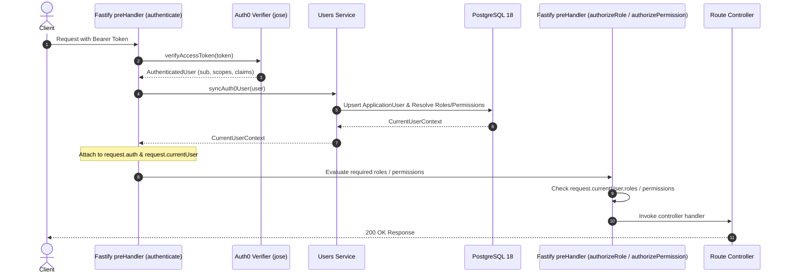

# Authorization Architecture & JIT User Synchronization — Fastify Server

This document outlines the authorization lifecycle, Just-in-Time (JIT) user profile synchronization, and Fastify preHandler hook implementation.

---

## 1. Architectural Principles

- **Decoupled Identity and Authorization**: Auth0 authenticates identity; Fastify manages internal application users, roles, permissions, and business rules.
- **Just-in-Time (JIT) Provisioning**: Upon presenting a valid Auth0 access token for the first time, a local `ApplicationUser` record is automatically created in PostgreSQL and assigned the default `USER` role.
- **Fail-Closed Security**: All protected routes enforce deny-by-default. If a user lacks the specified role or permission, a `403 Forbidden` response is returned immediately.

---

## 2. Request Lifecycle & Hook Pipeline



---

## 3. Account Status Gating

Before allowing any authenticated request to proceed, `usersService.syncAuth0User` evaluates account flags:

1. **`isActive === false`**: Account was deactivated by an administrator. Request is rejected with `403 Forbidden` (`ACCOUNT_INACTIVE`).
2. **`isBlocked === true`**: Account was suspended. Request is rejected with `403 Forbidden` (`ACCOUNT_SUSPENDED`).

---

## 4. Hook Usage in Fastify Route Definitions

```typescript
import { authenticate } from '../../plugins/auth.plugin.js';
import { authorizeRole } from '../../hooks/authorize-role.hook.js';
import { authorizePermission } from '../../hooks/authorize-permission.hook.js';
import { SYSTEM_ROLES } from '../../common/constants/roles.constants.js';
import { PERMISSIONS } from '../../common/constants/permissions.constants.js';

// Protect by role:
fastify.get(
  '/admin/dashboard',
  { preHandler: [authenticate, authorizeRole(SYSTEM_ROLES.SUPER_ADMIN, SYSTEM_ROLES.ADMIN)] },
  handler,
);

// Protect by permission:
fastify.get(
  '/users',
  { preHandler: [authenticate, authorizePermission(PERMISSIONS.USERS_READ)] },
  handler,
);
```
