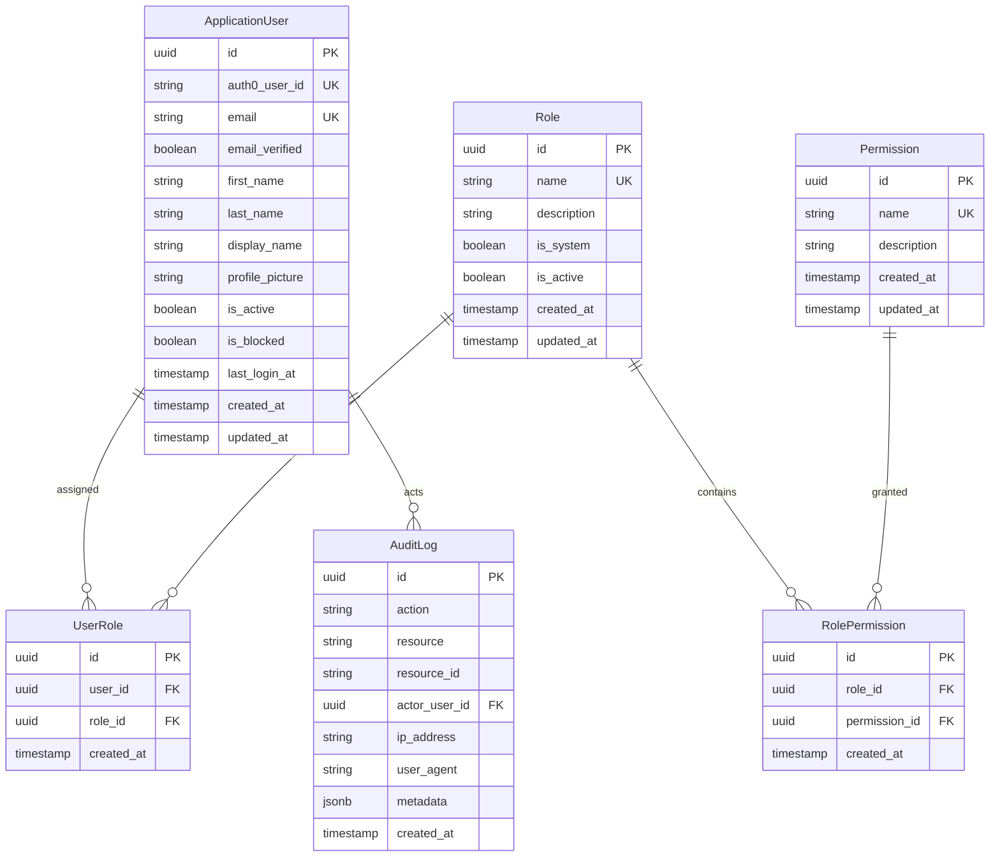

# Database Architecture & Prisma Schema Documentation — Fastify Server

This document outlines the PostgreSQL 18 database architecture, Prisma 7 ORM configuration, schema design, referential integrity rules, indexing strategies, and database seeding workflows for `fastify-server`.

---

## 1. Overview & Technology Stack

- **RDBMS**: PostgreSQL 18
- **ORM**: Prisma ORM 7.x
- **Driver**: `@prisma/adapter-pg` + `pg` (PostgreSQL client pool)
- **Primary Keys**: Universally Unique Identifiers (UUIDv4) generated via `gen_random_uuid()`
- **Code Generation**: Directed to `../src/generated/prisma` for full ESM compatibility

---

## 2. Entity-Relationship Model

---

## 3. Referential Integrity & Cascades

| Relationship | Foreign Key | Cascade on Delete | Business Safeguard |
|---|---|---|---|
| `UserRole` -> `ApplicationUser` | `user_id` | `CASCADE` | Deleting a user cleans up role associations. |
| `UserRole` -> `Role` | `role_id` | `CASCADE` | Guarded in service layer: system roles and in-use roles cannot be deleted. |
| `RolePermission` -> `Role` | `role_id` | `CASCADE` | Deleting a custom role drops its permission bindings. |
| `RolePermission` -> `Permission` | `permission_id` | `CASCADE` | Permissions are system-level and cannot be dropped while mapped. |
| `AuditLog` -> `ApplicationUser` | `actor_user_id` | `SET NULL` | Audit records persist forever even if the actor account is removed. |

---

## 4. Database Seeding Workflow

The seed script (`prisma/seed.ts`) is fully idempotent and executed via `npm run prisma:db:seed`.

### Seeded Assets:
1. **13 Granular Permissions**:
   - `users:read`, `users:create`, `users:update`, `users:delete`
   - `roles:read`, `roles:create`, `roles:update`, `roles:delete`, `roles:assign`
   - `permissions:read`, `permissions:manage`
   - `dashboard:read`
   - `audit-logs:read`

2. **5 System Roles**:
   - `SUPER_ADMIN`: Root authority with all permissions.
   - `ADMIN`: Operational administrator managing users, roles, and viewing analytics.
   - `MANAGER`: Supervisor role with read access to users, roles, and metrics.
   - `USER`: Standard end-user with self-service profile rights.
   - `VIEWER`: Auditor or guest with read-only permissions.

---

## 5. Prisma CLI Commands

| Command | Purpose |
|---|---|
| `npm run prisma:generate` | Generates the type-safe Prisma Client into `src/generated/prisma` |
| `npm run prisma:migrate:dev` | Creates and applies a new migration in local development |
| `npm run prisma:migrate:deploy` | Applies pending migrations in staging or production environments |
| `npm run prisma:migrate:reset` | Resets database, runs migrations from scratch, and seeds data |
| `npm run prisma:db:seed` | Runs the idempotent TypeScript database seed script (`prisma/seed.ts`) |
| `npm run prisma:studio` | Launches visual Prisma Studio GUI on `http://localhost:5555` |
| `npm run db:setup` | One-shot command: generates client and runs development migrations |
