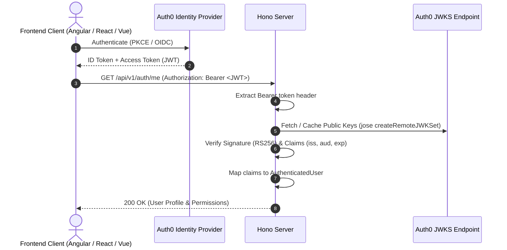

# Auth0 Integration Guide — Hono Server

This document details the Auth0 integration architecture, token verification mechanics, Hono middleware, and client integration contracts for `hono-server`.

---

## 1. Architectural Philosophy

**Auth0 manages authentication and identity. Hono verifies tokens and authorizes resources.**

The Hono application does NOT:
- Issue access tokens or refresh tokens.
- Handle password hashing or credential storage.
- Implement login or registration forms.

The Hono application:
- Verifies Auth0-issued asymmetric JSON Web Tokens (JWT) using Auth0's JSON Web Key Set (JWKS).
- Validates token claims: signature, expiration (`exp`), not-before (`nbf`), issuer (`iss`), and audience (`aud`).
- Extracts user identity, OAuth scopes, permissions, and namespaced roles.
- Protects routes with idiomatic Hono middleware (`authenticate` and `optionalAuthenticate`).

---

## 2. Token Verification Architecture



---

## 3. Cryptographic Verification Details

- **Library**: `jose` (v6.x)
- **Algorithm**: `RS256` (Asymmetric RSA Signature with SHA-256)
- **Public Key Resolution**: `createRemoteJWKSet` against `https://${AUTH0_DOMAIN}/.well-known/jwks.json`
- **JWKS Cache Strategy**:
  - `cacheMaxAge`: 10 minutes (`600,000ms`)
  - `cooldownDuration`: 30 seconds (`30,000ms`)
  - `timeoutDuration`: 5 seconds (`5,000ms`)
- **Key Rotation**: Automatic. If a token arrives with an unknown `kid` (Key ID), `jose` refetches the JWKS adhering to cooldown limits.

---

## 4. Environment Configuration

```env
AUTH0_DOMAIN=dev-example.us.auth0.com
AUTH0_AUDIENCE=https://api.auth0-auth-system.local
AUTH0_ISSUER_BASE_URL=https://dev-example.us.auth0.com/
AUTH0_ALGORITHMS=RS256
AUTH0_JWKS_URI=https://dev-example.us.auth0.com/.well-known/jwks.json
AUTH0_CLOCK_TOLERANCE=5
AUTH0_TOKEN_MAX_AGE=86400
AUTH0_ROLES_CLAIM_NAMESPACE=https://api.auth0-auth-system.local/roles
```

---

## 5. Middleware Usage in Hono

### Mandatory Authentication: `authenticate`

```typescript
import { Hono } from 'hono';
import { authenticate } from '../../middlewares/auth.middleware.js';

export const protectedRoutes = new Hono();

protectedRoutes.get('/me', authenticate, (c) => {
  const user = c.get('auth'); // AuthenticatedUser
  return c.json({ user });
});
```

### Optional Authentication: `optionalAuthenticate`

```typescript
import { Hono } from 'hono';
import { optionalAuthenticate } from '../../middlewares/auth.middleware.js';

export const publicOrPrivateRoutes = new Hono();

publicOrPrivateRoutes.get('/feed', optionalAuthenticate, (c) => {
  const user = c.get('auth'); // AuthenticatedUser | undefined
  return c.json({ personalized: Boolean(user) });
});
```

---

## 6. API Endpoints

### `GET /api/v1/auth/status`
- **Protection**: Public
- **Description**: Returns Auth0 integration status without exposing credentials.
- **Response**:
```json
{
  "success": true,
  "statusCode": 200,
  "message": "Auth0 integration status",
  "data": {
    "provider": "Auth0",
    "configured": true,
    "domain": "dev-example.us.auth0.com",
    "audience": "https://api.auth0-auth-system.local",
    "issuer": "https://dev-example.us.auth0.com/"
  },
  "timestamp": "2026-11-20T19:45:00.000Z"
}
```

### `GET /api/v1/auth/me`
- **Protection**: Mandatory (`Authorization: Bearer <token>`)
- **Description**: Returns verified caller identity, scopes, permissions, and roles.
- **Response**:
```json
{
  "success": true,
  "statusCode": 200,
  "message": "Authenticated user retrieved successfully",
  "data": {
    "sub": "auth0|64f1a2b3c4d5e6f7a8b9c0d1",
    "issuer": "https://dev-example.us.auth0.com/",
    "scopes": ["openid", "profile", "email"],
    "permissions": ["users:read", "users:write"],
    "roles": ["ADMIN"],
    "claims": {
      "email": "user@example.com",
      "email_verified": true
    }
  },
  "timestamp": "2026-11-20T19:45:00.000Z"
}
```
